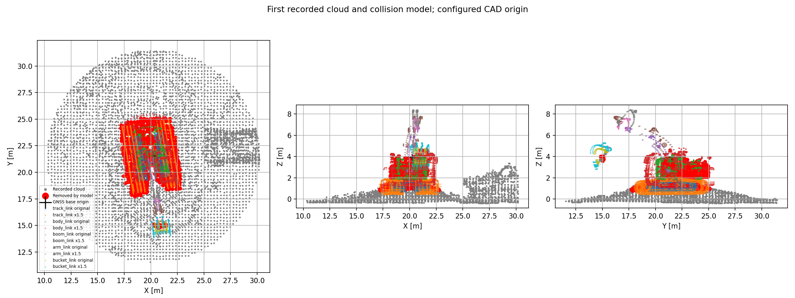
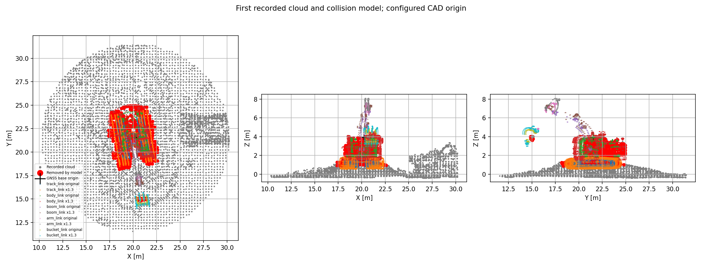
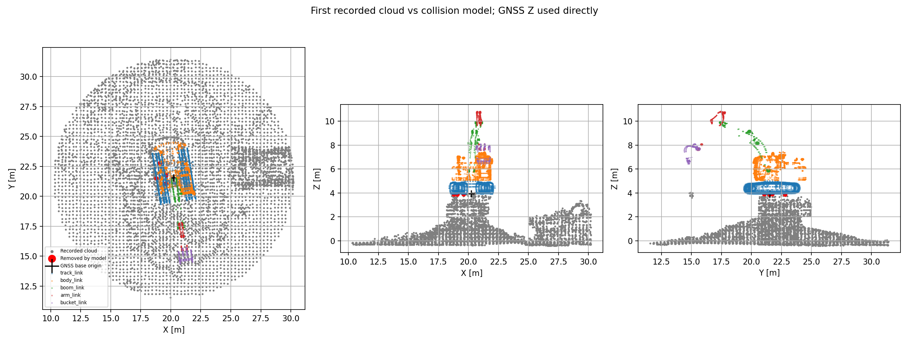
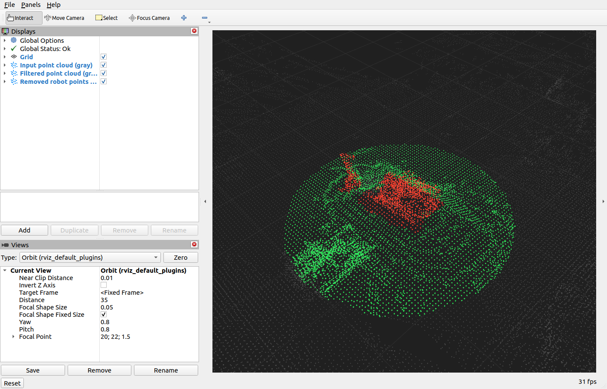

# 検証記録（2026-10-25）

## 最新設定：元モデルの1.5倍

`self_filter_scale: 1.50` に変更しました。元モデルから直接1.5倍で、以前の1.3倍をさらに1.5倍するものではありません。測定base→CAD原点の暫定補正、関節位置・関節角度、padding 0.30 mは維持します。

単純に最終倍率の表面へ移すだけでは、開いたCAD面で以前の除去範囲が抜ける問題があったため、原形から1.1/1.2/1.3/1.4/1.5倍の形状をORで合成します。Meshでは規則的なサンプル格子に加えて各辺の中点と重心を必ず検査するよう修正しました。

[1.5倍の全フレーム検証](scale15_validation_results.json) と
[旧1.3倍との点ごとの比較](scale13_scale15_comparison.json) を保存しています。

| 項目 | 結果 |
| --- | --- |
| 点群 | 163 / 163フレーム通過 |
| Mesh | 先頭・中央・末尾 × 5段階、15条件通過 |
| 旧1.3倍の除去点 | 全184488点を保持、取りこぼし0点 |
| 現在の除去点数 | 214997点（30509点、16.5%増） |
| 出力点数 | 5085〜6161点 |
| 指定モデル上の残存点 | 全フレーム0点 |
| 処理時間（検査・比較を含む） | 中央値約0.092秒、最大約0.123秒 |

拡大後は低所の除去も増え、map Z<0.8 mは2915点、Z<0 mは58点です。拡大したクローラやバケットの周囲で地形も除去対象になる可能性があります。これは高さによる代理指標で、ラベル付きの誤除去測定ではありません。



図は原形と最大倍率の外形を描き、中間倍率の外形は省略しています。赤点の判定には中間形状も含みます。以下は比較のために残した、以前の1.3倍設定での記録です。

## 以前の1.3倍設定での検証

対象は `rosbag/rosbag2_2026_10_25-08_46_47`、ROS 2 Humble / Python 3.10 / Open3D 0.16.0です。半径10 m、暫定CAD原点補正 `[-0.17, 0.30, -3.21] m`、姿勢補正ゼロ、自己除去padding 0.30 m、各リンク形状の膨張倍率1.30で検証しました。

## 結果と暫定較正

自己点群除去、PointCloud2/Mesh出力、状態欠落からの復帰を実装し、全163フレームとMesh 15条件の検査を通過しました。単体・DDS実通信・launchを含むテストは **120 passed / 1 skipped / failures 0** です。skipは以前からの著作権ヘッダ検査です。

初期状態では、ユーザー確認どおり `/zx200/global_pose` をbase_link原点として使うと、既存CADが実点群より上に配置されました。そのため「それっぽい値をあてがって」との追加指示に基づき、測定Pose自体は保持し、測定baseからCAD原点への暫定外部変換を導入しました。

- `model_origin_xyz: [-0.17, 0.30, -3.21]` m（測定baseの軸で表現）
- `model_origin_rpy: [0.0, 0.0, 0.0]` rad
- `self_filter_padding: 0.30` m

先頭フレームの中央にあるbody/trackの観測点と実メッシュ表面との距離を、soft-L1損失で評価しました。複数のZ初期値からXY/Z/yawの4自由度を最適化した結果、同じ並進付近・yawほぼ0に収束しました。推定には半径3 m・map Z>0.8 mの点を使い、地面全体への適合を避けています。中央・末尾でも固定値のまま比較し、body高所点の表面距離中央値が補正前約1.9 mから約0.11〜0.15 mに改善することを確認しました。

これは付属bag向けの推定値です。測量による外部較正ではありません。点群ラベルがないため、物理機体の完全な除去や地形の誤除去率は保証できません。既知の原点間変換を入手したら、この値を置き換えて同じ検証を再実行してください。

[推定の全計算結果](model_origin_calibration.json) と
[3フレームの比較図](model_origin_comparison.png) も保存しています。

原点補正と1.3倍膨張を適用した当時の重ね図です。灰色が入力、色付きが各モデルリンク、赤色が自己除去した点、黒十字が測定base位置です。



補正前も比較用に残しています。



| 条件 | CAD原点補正 | padding | 全163フレームの除去点数 |
| --- | --- | ---: | ---: |
| 補正前 | identity | 0.15 m | 1464 |
| 暫定原点補正、膨張なし | `[-0.17, 0.30, -3.21] m` | 0.30 m | 138795 |
| 当時の既定値、形状1.3倍 | `[-0.17, 0.30, -3.21] m` | 0.30 m | 184488 |

形状scale=1.0の状態でpaddingは0.15/0.25/0.30/0.35 mを比較しました。0.30 mでは0.15 mより中央の機体らしい高所点の残存が減り、代表3時刻でmap Z<0.8 mの除去は0点でした。**全フレーム**ではZ<0.8 mの除去は1039点（フレーム11〜41）、Z<0 mの除去は0点です。低所が除去されたフレーム11/25/41を個別に調べると、全て下降したbucketメッシュによるもので、固定クローラやbodyによる低所除去ではありませんでした。機体本体と接触地形の区別はできないため、これは低所除去の代理指標で、ラベル付きの誤除去測定ではありません。

## 1.3倍膨張とTF警告の修正

ユーザーの画面上の取りこぼしに対応し、各collisionの境界中心から形状を1.3倍に拡大しました。GNSS位置・関節位置・関節角度・0.30 mの距離余裕は維持しています。原形と拡大形状の判定をORで合成し、全163フレームで以前の除去点が全て保持されることを検査しました。

[膨張前後の比較JSON](scale_comparison.json) では、除去点数が138795→184488点（32.9%増）、中央値833→1105点/フレームに変わりました。膨張後のZ<0.8 mの除去は1614点、Z<0 mの除去は26点です。負のZの除去は掘削動作区間だけに発生しており、拡大したバケットの周囲で地形も除去する可能性があります。物理的な誤除去点と確定できるラベルはありません。

前回の実通信試験はROSドメインを分離し、RViz無効で行っていました。通常環境＋既定RViz起動の確認が不足していました。ユーザー提示ログでは `base_link_3d` の `TF_OLD_DATA` が大量発生しており、実行中のプロセスにはlaunchの自動bagと別ターミナルの手動bagの二重再生も確認しました。

同じchildに新しいTF→古いTFを別publisherから送る実通信再現で、修正前は20件の `TF_OLD_DATA` を確認しました。既定処理には不要な動的 `/tf` の購読・再生を止めた修正版は、同じ入力で警告0件、`/tf` 購読0件、static world/map変換による正常な出力を確認しました。[修正前](tf_old_data_before.json)・[修正後](tf_old_data_after.json) のレポートがあります。

`use_dynamic_tf:=true` の明示指定時は動的TFを利用でき、実DDSで測定時刻への補間を検証しました。ROS時計が巻き戻った場合には動的TF履歴をクリアし、static TFを保持します。

## 全bagの検査

[最終JSONレポート](validation_results.json) に静的TF、各フレームの計数・時刻差・処理時間を記録しています。[補正前レポート](uncalibrated_validation_results.json) も保存しています。

| 項目 | 結果 |
| --- | --- |
| 録画長 | 約60.475秒 |
| 点群 | 163 / 163フレーム処理成功 |
| PoseStamped | 5423件、全件frame_id空（設定worldを適用） |
| JointState | 17741件、必須4関節あり |
| static TF | 5メッセージ、world→mapあり |
| 最近傍poseとの最大header時刻差 | 16.95 ms |
| 最近傍jointとの最大header時刻差 | 13.93 ms |
| PointCloud2出力点数 | 5240〜6285点 |
| 自己モデルの除去点数 | 合計184488点 |
| 出力に残った指定モデル上の自己点 | 全フレーム0点 |
| 処理時間（比較検査を含む、warm cache） | 中央値約0.060秒、最大約0.072秒 |
| Mesh検証 | 先頭・中央・末尾 × 全5段階 = 15条件通過 |

| 点群フレーム（0始まり） | 入力点数 | 自己除去点数 | 最終出力点数 |
| ---: | ---: | ---: | ---: |
| 0 | 66330 | 1088 | 5464 |
| 81 | 65645 | 1104 | 5602 |
| 162 | 65455 | 1069 | 5550 |

PointCloud2ではHeader、フィールド、point_step、全点属性とrecord内paddingのバイト一致、有限性、半径内制約を検査しました。Meshでは非空の面、有限頂点、有効な三角形インデックス、頂点・重心・辺中点が自己モデル外であること、RViz MarkerのHeaderと頂点列を検査しました。

計測headerとbag記録時刻には約146330秒の差があります。すべて計測header同士を照合しています。offline検証は全状態を先に読み、計測時刻が最も近い状態を選びます。liveでは受信済み履歴だけを使うため、まだ届いていない未来側の状態は使いません。

## 単体・DDS通信

- world→mapの逆変換、回転/並進、空frame補完、測定姿勢と関節FK、明示的CAD原点補正。
- 実メッシュ全頂点、COLLADAの単位・up_axis・階層回転/並進、水密内部、開いた面、正確な表面距離。
- 最寄り実測値、部分関節の個別鮮度、履歴上限、bag巻き戻り、欠落/重複/非有限角度の拒否。
- XY円の境界、高さ制限なし、SOR、voxel、NaN/Inf、空入力。自己除去がvoxelより前であること。
- PointCloud2の行padding・endianness・全属性、Mesh全5段階・垂直面・曲面・分離面、自己除去領域を跨ぐ三角形の抑制。
- 実DDSで非自明なworld/map/base/関節回転を合成し、人工自己4点を除去、地形81点を保持。PointCloud2/Mesh両方で確認。
- 関節欠落/古い部分更新/TF不足で出力を見送り、受信後に自動復帰。自己除去無効時のゼロstamp・姿勢なしcropとの互換。
- source/installのbagパス解決、launch引数、ノード準備完了後のbag起動、flake8・pep257。

DDSの検査には通信インターフェースが必要です。本環境のサンドボックス内ではROS 2がインターフェースを列挙できなかったため、許可済みの制限外環境で実通信テストを実施しました。

## ROS launchでの実再生

比較用のscale=1.0では、標準速度で全bagをPointCloud2/Meshの両モードで再生し、実際の購読側で出力と補助トピックを検査しました。[膨張前PointCloud2レポート](scale1_live_pointcloud2.json) と [膨張前Meshレポート](scale1_live_mesh.json) を保存しています。各モードで163/163入力・10秒周期の7回出力を確認し、bag終了後の最後の未処理点群も処理しています。Header・属性・除去点群、MeshのHeader/Markerの整合、bagとフィルタの正常終了を検査しました。膨張前の実通信出力では自己点715〜980点/回を除去しました。両モードは別プロセスでタイマー位相が異なるため、一部の周期で選ばれる入力フレームは異なります。

scale=1.3当時の・static TFのみのMesh再生も、163入力・7回のMesh/Header/Marker/除去点群で正常完了しました。除去点は965〜1267点/周期で、Headerと点属性の整合、TF_OLD_DATA・状態解決エラー0件、SIGINT後の正常終了を確認しています。[最新Mesh実再生レポート](live_mesh.json)・[ログ](live_mesh.log) に記録しています。

通常のROSドメイン（ROS_DOMAIN_ID未設定、0）とRViz有効の構成でも起動しました。検証中の他出力との衝突を避けるため出力名だけ `/pcf_validation/filtered` に変更し、通常workspaceのインストールを使用しています。画面で **Global Status: Ok** と灰色の入力・緑色の残存点・赤色の除去点を確認しました。全163入力・7回の出力、Header/全record属性の保持、TF_OLD_DATAゼロ、bagとRViz/フィルタの正常終了を検査し、全チェックが通過しました。[通常環境＋GUIのレポート](live_pointcloud2.json)・[ログ](live_pointcloud2.log) を保存しています。初回のシミュレーション時計への切替でRVizが一度Resetしたログはありますが、TF_OLD_DATAではありません。



初期化完了ログ `Ready for point clouds.` の後でbagプロセスを起動し、さらにDDS発見用に2秒待ちます。モデル読込みに時間がかかっても準備前に再生は進みません。SIGINTはlaunch親へ送り、子ノードの正常終了も確認しています。

## 再現

```bash
source /opt/ros/humble/setup.bash
cd /home/kasahara/SIP_PROJECTS/ros2_tms_ws/src/pointcloud_filters
PYTHONPATH=.:$PYTHONPATH OMP_NUM_THREADS=2 OPENBLAS_NUM_THREADS=2 \
  python3 scripts/validate_bag.py \
  --report /tmp/pointcloud_filters_validation.json \
  --preview /tmp/pointcloud_filters_overlay.png
```

`--params` に較正済みYAMLを指定して再検証できます。実機の適合率・誤除去率の保証には正しい外部較正とラベル付き評価が必要です。有限サンプリングによるMesh交差検査、開いたCAD面の内外判定の制約はREADMEとrobot/READMEにも記載しています。

暫定原点の推定も再現できます。このコマンドは設定や測定Poseを書き換えません。位置合わせは膨張前のscale=1.0の形状で行います。この旧記録のscale=1.3の除去範囲の検査には上のvalidate_bag.pyを使用します。

```bash
PYTHONPATH=.:$PYTHONPATH OMP_NUM_THREADS=2 OPENBLAS_NUM_THREADS=2 \
  python3 scripts/calibrate_model_origin.py \
  --output /tmp/model_origin_calibration.json \
  --preview /tmp/model_origin_comparison.png
```
